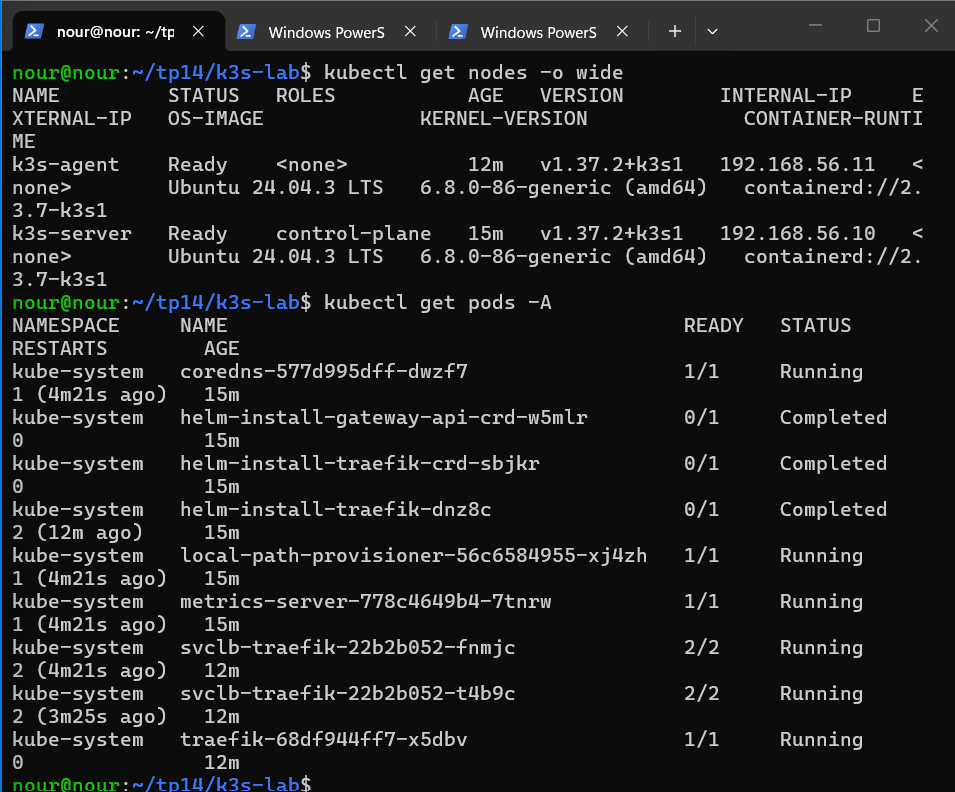
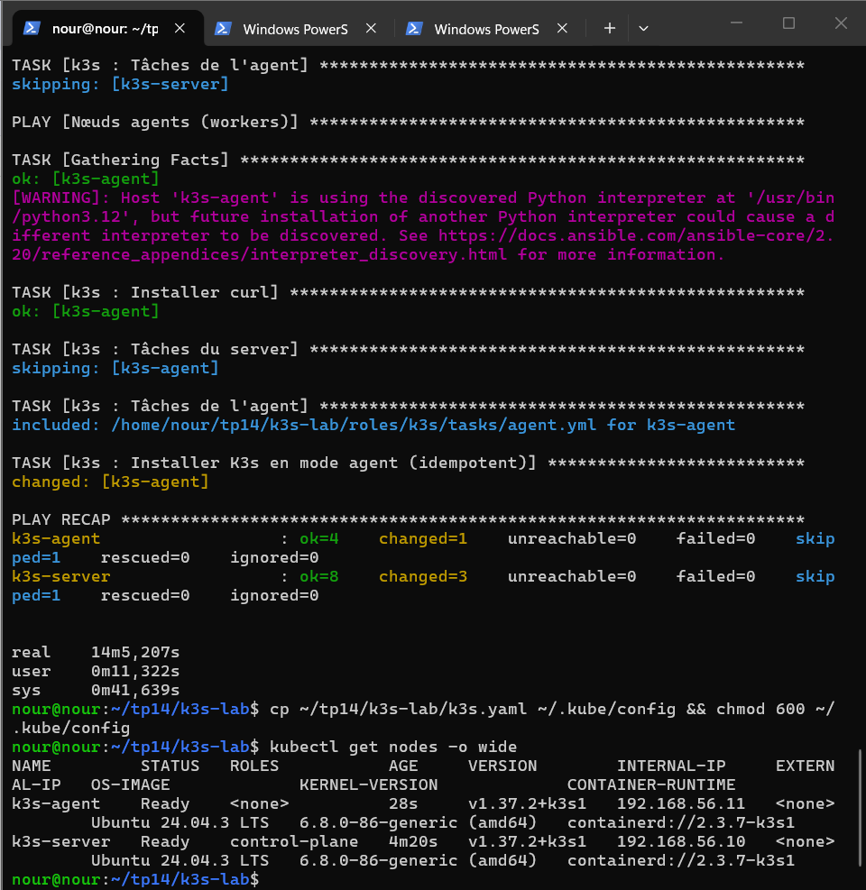
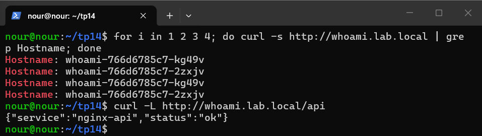
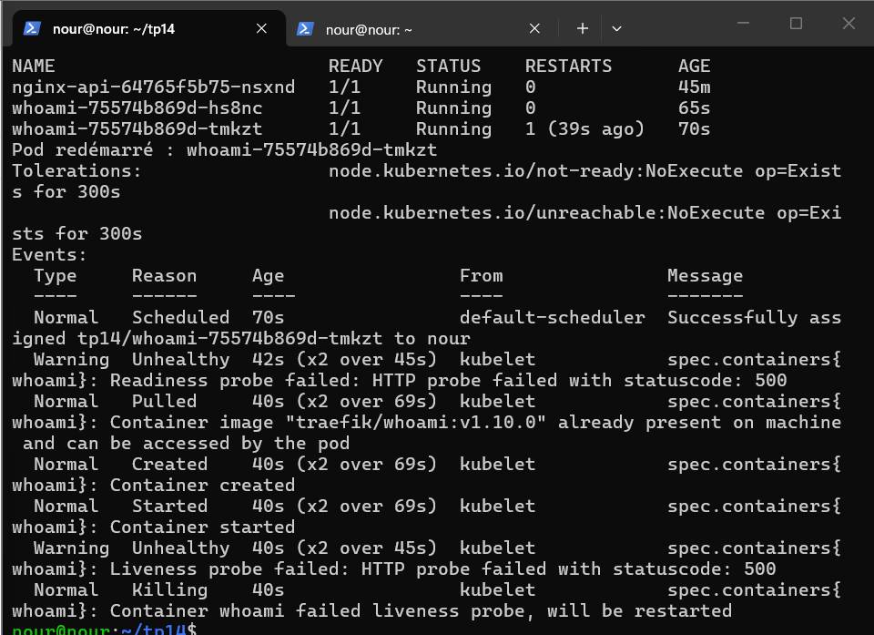
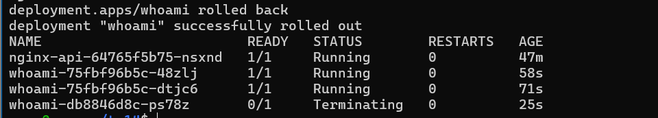
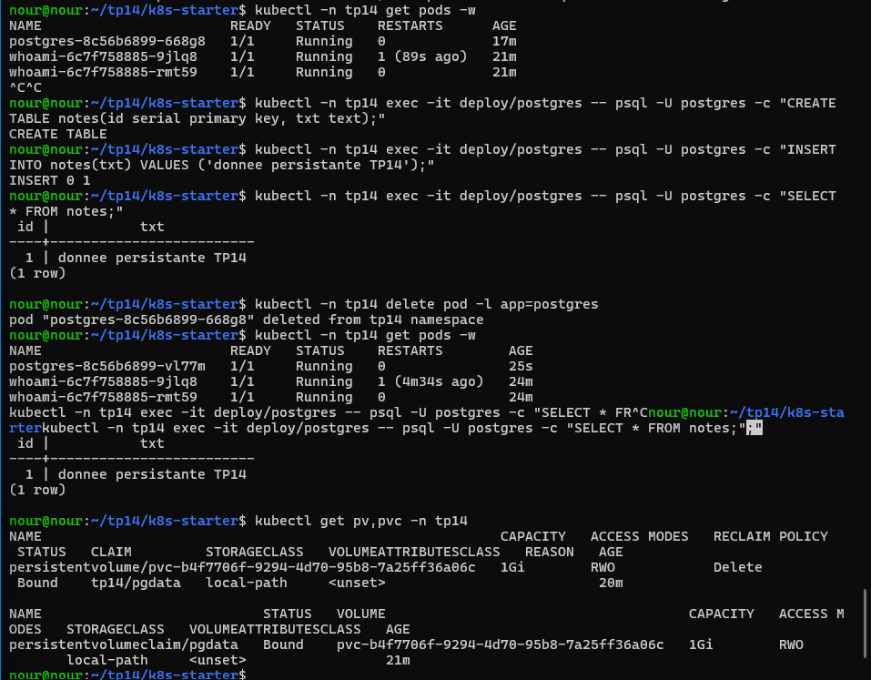
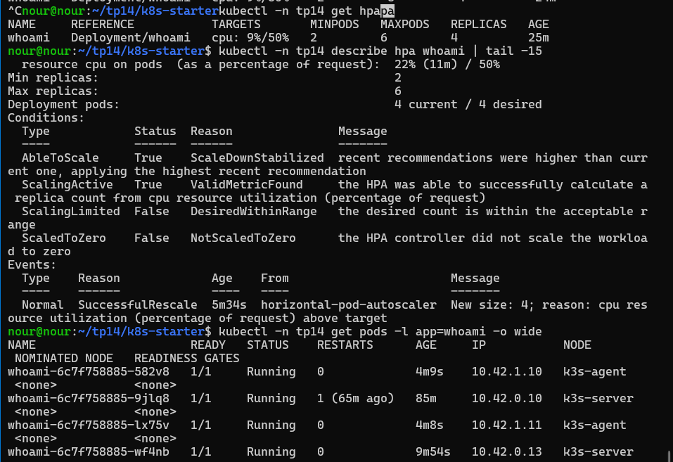

# TP14 : Kubernetes avec K3s

**Étudiante :** Nour Kidoudi, Master DevOps & Cloud Computing, ISET Tozeur

## Contenu
- `k3s-lab/` : Vagrantfile (2 VM) et rôle Ansible `k3s` (server + agent)
- `k8s-starter/` : manifests (Namespace, ConfigMap, Deployment, Service, Ingress, PostgreSQL + PVC, HPA)
- `captures/` : captures d'écran

Les secrets (`whoami-secret`, `postgres-secret`) sont créés en ligne de commande et ne sont pas versionnés.

## Partie 1 : cluster K3s (Vagrant + Ansible)
Cluster à 2 nœuds (`k3s-server`, `k3s-agent`) créé avec Vagrant et provisionné par un rôle Ansible `k3s`.

Reconstruction avec `vagrant destroy -f && vagrant up` : durée (à compléter).

## Partie 2 : Pods et Deployments
- Un Pod lancé à la main (`kubectl run`) n'est **pas** recréé après suppression : aucun contrôleur ne surveille son état désiré. Le Deployment crée un ReplicaSet qui recrée les Pods supprimés.
- Les Pods du Deployment sont répartis sur les deux nœuds (à compléter : confirmer avec `get pods -o wide`).
- `kubectl exec ... -- sh` échoue sur l'image whoami : l'image est minimale et ne contient pas de shell.

## Partie 3 : Services et Ingress
Le Service sélectionne les Pods par label et crée des endpoints ; l'Ingress Traefik route `whoami.lab.local` vers le Service.

## Partie 4 : ConfigMap et Secret
`base64` n'est pas du chiffrement : n'importe qui avec accès au Secret peut décoder sa valeur. Après modification d'une ConfigMap, les variables d'environnement des Pods existants ne changent pas : il faut `kubectl rollout restart`.

## Partie 5 : santé, ressources, déploiements
La livenessProbe redémarre le Pod quand `/health` renvoie 500.

Rolling update et rollback après une image inexistante (`v9.9.9`) :

Le service n'est jamais interrompu : `maxUnavailable: 0` impose de garder tous les Pods existants, `maxSurge: 1` n'en ajoute qu'un nouveau à la fois, et la `readinessProbe` n'envoie du trafic qu'à un Pod prêt. Le Pod à l'image inexistante reste en `ImagePullBackOff`, jamais `Ready`, donc l'ancienne version continue de servir.

## Partie 6 : stockage persistant
PostgreSQL avec un PVC `local-path`. Une table est créée, le Pod est supprimé, la donnée est toujours présente après recréation.

Avec `local-path`, les données sont stockées dans un dossier du disque du nœud qui héberge le Pod. Si le Pod est replanifié sur un autre nœud, il ne retrouve pas ses données : le volume est lié à un nœud.

## Partie 7 : HPA
L'HPA (`minReplicas: 2`, `maxReplicas: 6`, cible 50 % du CPU demandé) a fait passer le Deployment de 2 à 4 réplicas sous charge.

## Difficultés rencontrées
- Téléchargement de K3s via Ansible interrompu (réseau lent) : binaire téléchargé de façon reprenable puis installé avec `INSTALL_K3S_SKIP_DOWNLOAD=true`.
- (à compléter si tu veux ajouter d'autres points)
